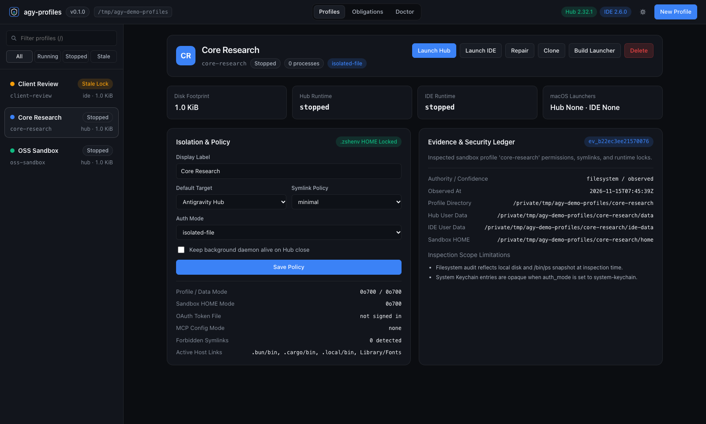

# agy-profiles

Clean-room multi-profile sandbox manager, stdio MCP server, and hardened localhost console for Google Antigravity on macOS.



## Overview

Running multiple accounts, client workspaces, or untrusted repositories inside Google Antigravity Hub and Antigravity IDE risks cross-profile authentication bleed, shell login environment leakage, stale Chromium locks, and unintentional credential exposure. `agy-profiles` solves this through strict directory containment (`0o700` / `0o600`), locked `.zshenv` `HOME` rewriting, fail-closed MCP configuration sanitization, exact `--user-data-dir` process matching, and cryptographic CSRF/Origin isolation on its local web interface.

This repository is built purely on the Python 3 standard library (`>= 3.9`) with zero third-party runtime or test dependencies.

## Key Capabilities

1. **Strict Sandbox Isolation**: Provisions per-profile `data/`, `ide-data/`, `home/`, and `logs/` directories under `/Volumes/Dev/.antigravity-profiles` (when writable on macOS, or `~/.antigravity-profiles`, overridable via `AGY_PROFILES_DIR` or `--root`). Writes an immutable `0o600` `.zshenv` pinning `HOME` and `ZDOTDIR` inside the profile so macOS login shell environment discovery never pulls host credentials.
2. **Dual Target Support (`hub` and `ide`)**: Launches and tracks both `/Applications/Antigravity.app` (Antigravity Hub) and `/Applications/Antigravity IDE.app` (Antigravity IDE) inside isolated `--user-data-dir` and `--extensions-dir` paths, automatically setting `app_storage.json` and IDE `settings.json` flags to disable background auto-updaters.
3. **Fail-Closed Secret Sanitizer, Automations Migration, and Bidirectional Handoff**: Copies host `projects/`, `sidecars/` (Automations), `plugins/`, `agents/`, `skills/`, `hooks.json`, `GEMINI.md`, `settings.json`, `trustedFolders.json`, and `mcp_config.json` via default `--inherit-config` or `agy-profiles sync` while redacting secrets, rewriting `.gemini` paths inside Automations to the sandbox, pruning deleted Host items, and defaulting Automations to `paused` standby (`active` on quota switchover or `strip` to omit). Reads SQLite conversations strictly read-only in both directions (`--from host` or `--from <profile>`) to write `HANDOFF_CONTEXT.md`.
4. **Symlink Allowlist and Blocklist**: Rejects and strips symlinks pointing to sensitive host locations (`.ssh`, `.gnupg`, `.aws`, `.kube`, `.npmrc`, `.netrc`, `.pypirc`, `Library/Keychains`, `.gemini`, shell startup dotfiles). Offers opt-in link policies (`none`, `minimal`, `dev` default on CLI) for benign runtime binaries, `.agents` shared rules under `dev`, and fonts.
5. **Exact Process Boundary Matching**: Tracks and stops processes only when `--user-data-dir=<resolved_path>` matches at strict token boundaries, including descendant child processes discovered via parent-PID traversal. Escalates cleanly from `SIGTERM` to `SIGKILL` and repairs stale Chromium locks (`SingletonLock`, `SingletonSocket`, `SingletonCookie`, `DevToolsActivePort`).
6. **Evidence, Accounts, and Obligation Ledgers**: Detects signed-in Host and sandbox Google account emails without leaking tokens, emits structured `EvidenceRecord` metadata (`evidence_id`, `authority`, `confidence`, `facts`, `limitations`) on inspections, verifies `.app` code signatures on Apple Silicon, and exposes six executable security self-checks via `agy-profiles obligations`.
7. **Zero-Dependency Local Surfaces and Antigravity Plugin**: Includes an `argparse` CLI (`agy-profiles` / `agyp`) with one-command `switch`, a stdio JSON-RPC 2.0 MCP server exposing 17 tools (`agy-profiles mcp`), ad-hoc signed macOS `.app` launchers (`agy-profiles launcher build`), a native Antigravity Hub Aux Pane plugin (`antigravity-plugin/` installed via `./install.sh --with-plugin`), and an Astryx Design System Web Console (`agy-profiles web`) with `Gothic Studio`, `Gothic`, and `Neutral` themes.

## Installation

Install `agy-profiles` and its short alias `agyp` into `~/.local/bin` via symlink:

```bash
git clone https://github.com/harrymove-ctrl/agy-profiles.git /Volumes/Dev/agy-profiles
cd /Volumes/Dev/agy-profiles
./install.sh
```

Useful installer options:

```bash
./install.sh --dry-run
./install.sh --prefix ~/.local/bin --with-skill --with-plugin
./install.sh --uninstall --with-skill --with-plugin
```

You can also run directly from the repository without modifying `PATH`:

```bash
./bin/agy-profiles doctor --json
```

## Quick Start

1. Check host Antigravity bundles and sandbox health:

```bash
agy-profiles doctor
```

2. Verify built-in security and isolation invariants:

```bash
agy-profiles obligations
```

3. Create an isolated profile (defaults to `--links dev --inherit-config` with Automations synced in paused standby):

```bash
agy-profiles create core-research --label "Core Research" --target hub
```

4. Re-sync sanitized host customizations, control Automations mode (`paused`, `active`, `strip`), read bidirectional handoff digests, or run one-command quota takeover:

```bash
agy-profiles sync core-research --automations paused --restart
agy-profiles handoff --from host
agy-profiles switch core-research --copy-prompt
agy-profiles switch host --from core-research --copy-prompt
```

5. Launch Antigravity Hub or IDE for that profile:

```bash
agy-profiles launch core-research
agy-profiles launch core-research --target ide --workspace /Volumes/Dev/my-repo
```

6. Build a native Spotlight and Dock `.app` bundle launcher:

```bash
agy-profiles launcher build core-research --target hub
```

7. Open the local Web Console on `127.0.0.1`:

```bash
agy-profiles web
```

8. Connect an AI coding client to the stdio MCP server:

```json
{
  "mcpServers": {
    "agy-profiles": {
      "command": "agy-profiles",
      "args": ["mcp"]
    }
  }
}
```

## Web Console and Frontend Build

The local Web Console (`agy-profiles web`) is built with React 19, TypeScript, `@astryxdesign/core`, and `@stylexjs/stylex` from `web-ui/`, then pre-compiled with Vite into `src/agy_profiles/web_static/` (`index.html`, `styles.css`, `app.js`, `mark.svg`, `fonts/*.woff2`) so end users install and run `agy-profiles` with zero Node or PyPI runtime dependencies.

1. **Astryx Design System & Themes**: Uses the customized `Gothic Studio` dark theme by default (built with the Astryx Theme Editor extending `Gothic` with crisp obsidian surfaces, hairline borders, medium scale, and small corners) alongside `Gothic` and `Neutral` (with Light and Dark mode switching), plus six profile accent presets.
2. **Self-Hosted Typography**: Bundles `Fustat Variable`, `Manufacturing Consent`, `UnifrakturMaguntia`, `Figtree Variable`, and `JetBrains Mono Variable` `.woff2` font files directly inside `src/agy_profiles/web_static/fonts/` with zero external `fonts.googleapis.com` requests.
3. **Interactive Console Workflows**: Provides `TopNav` and `SideNav` switching across `Profiles`, `Handoff`, `Obligations`, and `Doctor`, signed-in Host and profile Google account badges, `LayoutHeader` action bars with one-click `Sync Setup`, copyable cross-account resume prompts in `Handoff`, `Avatar` + `AvatarStatusDot` identity indicators, a profile creation `Drawer`, confirmation controls, and keyboard shortcuts (`/` to filter profiles, `n` to open Create Profile, `r` to refresh live state).
4. **Loopback & CSP Hardening**: Binds strictly to `127.0.0.1` or `::1`, authenticates requests via 365-day sliding signed session cookies backed by `0o600` `.web-secrets.json` plus `X-AGY-CSRF`, enforces `script-src 'self'` and `font-src 'self'`, and isolates `/fonts/` static serving with single-segment extension checks.
5. **Rebuilding Frontend Assets (Optional Dev Only)**:

```bash
cd web-ui
npm install
npm run build
```

This updates `src/agy_profiles/web_static/` directly for packaging and verification (`docs/assets/web-console-overview.png`).

## CLI Command Reference

| Command | Purpose |
| :--- | :--- |
| `agy-profiles list [--json]` | List all profiles, runtime states, disk sizes, and detected host targets. |
| `agy-profiles create <name> [flags]` | Provision a new sandbox profile with strict directory modes. |
| `agy-profiles inspect <name> [--json]` | Inspect permissions, symlinks, live PIDs, and `EvidenceRecord` output. |
| `agy-profiles update <name> [flags]` | Update label, accent color, default target, symlink policy, or auth mode. |
| `agy-profiles sync <name> [--automations paused\|active\|strip] [--from host\|<profile>] [--restart]` | Sync sanitized host projects, Automations, plugins, agents, skills, rules, MCP JSON, and handoff while pruning removed Host items. |
| `agy-profiles switch <name> [--automations active\|paused\|strip] [--workspace <dir>] [--copy-prompt]` | Check git cleanliness, sync setup and handoff, activate Automations, copy resume prompt, and launch target profile. |
| `agy-profiles handoff [--from host\|<profile>] [--limit 10]` | Read recent Host or profile Antigravity conversations strictly read-only for bidirectional quota handoff. |
| `agy-profiles launch <name> [--target hub\|ide]` | Launch Hub or IDE inside the profile sandbox. |
| `agy-profiles stop <name> [--target hub\|ide\|all]` | Stop verified profile processes with `SIGTERM` and `SIGKILL` escalation. |
| `agy-profiles repair <name> [--target hub\|ide]` | Clean stale Chromium lock files and reconcile `.zshenv` permissions. |
| `agy-profiles clone <source> <target> [--fresh-auth]` | Clone a stopped profile while excluding transient locks and optionally stripping OAuth tokens (`--fresh-auth`). |
| `agy-profiles rename <source> <target> [--label ...] [--restart]` | Rename a profile slug and display label while keeping OAuth credentials intact. |
| `agy-profiles delete <name> [--force-stop] [--yes]` | Delete a profile sandbox safely inside root boundaries. |
| `agy-profiles launcher build\|remove <name>` | Compile and ad-hoc sign (or remove) a macOS `.app` bundle using `osacompile` and `codesign`. |
| `agy-profiles doctor [--json]` | Inspect host Antigravity binaries, `.app` signatures, storage root modes, and stale locks. |
| `agy-profiles obligations [--json]` | Execute and report all six live security obligation checks. |
| `agy-profiles mcp` | Serve 17 tools over line-delimited JSON-RPC 2.0 stdio. |
| `agy-profiles web [--host 127.0.0.1] [--port 47920] [--sidecar]` | Start the CSRF-guarded local web console or Antigravity Aux Pane sidecar service. |
| `agyp daemon [install\|status\|open\|restart\|uninstall]` | Install and manage persistent 24/7 macOS `launchd` services (`watchdog` wrapped in `caffeinate -i` plus the loopback Web Console). |
| `agyp watchdog [--interval 5] [--once]` | Poll active logs and automatically switch quota, clickable sessions, and Automations onto the standby profile on exhaustion. |
| `agyp auto` / `agyp agy <name>` | Run terminal `agy` CLI with Turbo permissions, Antigravity Mobile remote control, and mid-session automatic quota failover. |
| `agy-profiles watch` / `agyp top` `[--theme sacred\|gothic\|catppuccin\|amber\|ascii] [--once] [--redact] [--export-svg <path>]` | Run the zero-dependency SRCL and WebTUI inspired ASCII terminal telemetry dashboard or export dark-mode SVG cards for X and GitHub. |

## Verification and Testing

Run the full zero-dependency test suite across Python 3.9 and 3.14, plus the secret and contamination scanner:

```bash
python3 -m unittest discover -s tests -v
python3 scripts/check_secrets.py
```

## Documentation

1. [Architecture Overview](docs/ARCHITECTURE.md): Five-layer clean-room module design, shell isolation rationale, and lock lifecycle.
2. [Reconstruction Obligations](docs/OBLIGATIONS.md): Live invariant definitions verified on every release.
3. [Security Model](SECURITY.md): Threat model, CSP/CSRF controls, symlink jail, and fail-closed redaction guarantees.

## License

MIT License. See [LICENSE](LICENSE).
